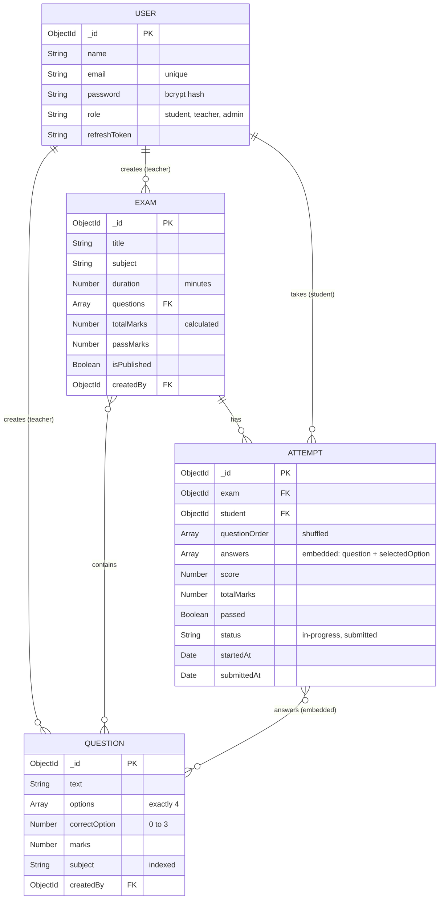

# ExamPortal – Online Examination System (MERN)

A full-stack online exam system where **teachers** build a question bank and create timed exams, **students** take each exam once with a countdown timer and see their results, and **admins** manage users and see portal-wide statistics.

Capstone Project 22 – Web Dev III

## 🔗 Live Links

| | Link |
|---|---|
| **Frontend (React, Vercel)** | https://exam-portal-black-ten.vercel.app |
| **Backend API (Express, Render)** | https://examportal-api-hlxv.onrender.com |

> The backend is on Render's free plan, so it sleeps after 15 minutes. The **first request can take about 50 seconds** while it wakes up. After that it is fast.

## 🔑 Demo Accounts

The login page also has one-click **Admin / Teacher / Student** demo buttons.
All passwords are **`123456`**.

| Role | Email |
|---|---|
| Admin | admin@examportal.com |
| Teacher | priya@examportal.com, rahul@examportal.com |
| Student | aman@examportal.com, neha@examportal.com, rohan@examportal.com, simran@examportal.com |

## ✨ Features

**Student**
- See published exams and start one (only **one attempt** per exam)
- **Countdown timer** that turns red under 1 minute and **auto-submits at 0:00**
- Questions come in a **different random order** for every student
- Answers are kept if the page is refreshed during the exam
- Result page with score, pass/fail and correct vs. chosen answer for each question
- "My Results" history

**Teacher**
- **Question bank**: add, edit, delete, search, filter by subject, pagination
- **Create exams** by ticking questions (total marks are calculated on the server)
- Publish / unpublish exams (students only see published exams)
- **Results page** per exam: attempts, average, highest, lowest, pass %, each student's score and answers, and a question analysis (hardest question first)

**Admin**
- Overview: users per role, questions, exams and performance of every exam
- Manage users: filter by role, change role (e.g. make a student a teacher), delete

**Security / rules on the server**
- Passwords hashed with **bcrypt**
- **JWT access token (15 min) + refresh token (7 days)**, refresh token cancelled on logout
- Role-based access: student / teacher / admin routes
- Correct answers are never sent to a student before they submit
- Marks are calculated on the server (a fake score sent by the frontend is ignored)
- Time limit is checked on the server (+30 seconds grace), late answers are not accepted
- An exam cannot be edited or deleted after a student has attempted it
- A question cannot be deleted while an exam uses it

## 🛠 Tech Stack

| Part | Technology |
|---|---|
| Frontend | React (Vite), React Router, Context API, plain CSS, `fetch` |
| Backend | Node.js, Express 5, MVC structure |
| Database | MongoDB Atlas, Mongoose |
| Auth | bcrypt, jsonwebtoken (access + refresh tokens) |
| Deployment | Vercel (frontend), Render (backend), MongoDB Atlas (database) |

## ✅ Capstone Requirements

| Requirement | Where |
|---|---|
| MVC backend | `backend/model`, `backend/controller`, `backend/routes` |
| `.env` config | `backend/.env.example`, `frontend/.env.example` |
| bcrypt + JWT access & refresh tokens | `backend/controller/auth.controller.js` |
| Protected route | `GET /api/auth/me` (`verifyToken`) |
| RBAC routes | `isAdmin`, `isTeacher`, `isStudent` in `backend/middleware/auth.middleware.js` |
| Mongoose validation | e.g. exactly 4 options, role enum, email format, min values |
| Relationships | Exam → Questions, Attempt → Exam / Student, created by → User |
| Aggregation | `backend/controller/report.controller.js` (`$match`, `$group`, `$avg`, `$max`, `$min`, `$sum`) |
| Index | `Question { subject }`, unique `Attempt { exam, student }`, unique `User { email }` |
| Error-handling middleware | `backend/middleware/error.middleware.js` |
| Postman collection | `postman/ExamPortal.postman_collection.json` |
| React: router, controlled forms, Context API, protected pages | `frontend/src` (`App.jsx`, `context/AuthContext.jsx`, `components/ProtectedRoute.jsx`) |
| Deployed links | see top of this file |

## 🗂 ER Diagram



- **Referenced:** an Exam stores the ids of its Questions; an Attempt stores the ids of its Exam and Student.
- **Embedded:** a student's answers are stored inside the Attempt, because they are always read together with it.
- **Unique index** on `{ exam, student }` makes sure a student can attempt an exam only once.

## 📡 API Routes

Base URL: `https://examportal-api-hlxv.onrender.com`
Protected routes need the header `Authorization: Bearer <accessToken>`.

**Auth**
| Method | Route | Access | Description |
|---|---|---|---|
| POST | `/api/auth/register` | Public | Register (always as student) |
| POST | `/api/auth/login` | Public | Login, returns access + refresh token |
| POST | `/api/auth/refresh` | Public | New access token from refresh token |
| POST | `/api/auth/logout` | Public | Cancel the refresh token |
| GET | `/api/auth/me` | Logged in | Current user |

**Users**
| Method | Route | Access | Description |
|---|---|---|---|
| GET | `/api/users?role=` | Admin | List users |
| PATCH | `/api/users/:id/role` | Admin | Change role |
| DELETE | `/api/users/:id` | Admin | Delete user |

**Questions**
| Method | Route | Access | Description |
|---|---|---|---|
| POST | `/api/questions` | Teacher | Add question |
| GET | `/api/questions?subject=&search=&page=&limit=` | Teacher | List own questions |
| GET | `/api/questions/:id` | Teacher | One question |
| PUT | `/api/questions/:id` | Teacher | Update question |
| DELETE | `/api/questions/:id` | Teacher | Delete (blocked if used in an exam) |

**Exams**
| Method | Route | Access | Description |
|---|---|---|---|
| GET | `/api/exams` | Logged in | Teacher: own exams, Student: published, Admin: all |
| GET | `/api/exams/:id` | Logged in | Student gets a summary only (no questions) |
| POST | `/api/exams` | Teacher | Create exam |
| PUT | `/api/exams/:id` | Teacher | Update (blocked after an attempt) |
| PATCH | `/api/exams/:id/publish` | Teacher | Publish / unpublish |
| DELETE | `/api/exams/:id` | Teacher | Delete (blocked after an attempt) |

**Attempts**
| Method | Route | Access | Description |
|---|---|---|---|
| POST | `/api/attempts/start/:examId` | Student | Start / continue, shuffled questions without answers |
| POST | `/api/attempts/:id/submit` | Student | Submit answers, graded on the server |
| GET | `/api/attempts/my` | Student | My attempt history |
| GET | `/api/attempts/exam/:examId` | Teacher | All attempts of one exam |
| GET | `/api/attempts/:id` | Owner / exam's teacher / admin | Detailed result |

**Reports (aggregation)**
| Method | Route | Access | Description |
|---|---|---|---|
| GET | `/api/reports/exam/:examId` | Teacher | Average, highest, lowest, pass %, per-question correct % |
| GET | `/api/reports/overview` | Admin | Users per role, totals, summary of every exam |

## 📁 Folder Structure

```
ExamPortal/
├── backend/
│   ├── config/db.js
│   ├── controller/      auth, user, question, exam, attempt, report
│   ├── middleware/      auth (verifyToken + roles), error handler
│   ├── model/           user, question, exam, attempt
│   ├── routes/
│   ├── seed.js          demo data
│   └── server.js
├── frontend/
│   └── src/
│       ├── api.js       all API calls (auto token refresh)
│       ├── context/     AuthContext
│       ├── components/  Navbar, ProtectedRoute
│       └── pages/       Login, Register, student/, teacher/, admin/
└── postman/
```

## 💻 Run Locally

You need Node.js and MongoDB running on your computer.

```bash
git clone https://github.com/Shivom-Sood/ExamPortal.git
cd ExamPortal
```

**Backend**
```bash
cd backend
npm install
cp .env.example .env     # then put your own secrets in .env
npm run seed             # optional: fill the database with demo data
npm run dev              # http://localhost:5050
```

**Frontend** (in a second terminal)
```bash
cd frontend
npm install
cp .env.example .env
npm run dev              # http://localhost:5173
```

## ⚙️ Environment Variables

**backend/.env**
| Name | Example |
|---|---|
| `PORT` | `5050` |
| `MONGO_URI` | `mongodb://127.0.0.1:27017/examportal` |
| `JWT_ACCESS_SECRET` | any long random string |
| `JWT_REFRESH_SECRET` | another long random string |
| `ACCESS_TOKEN_EXPIRY` | `15m` |
| `REFRESH_TOKEN_EXPIRY` | `7d` |
| `CLIENT_URL` | `http://localhost:5173` |

**frontend/.env**
| Name | Example |
|---|---|
| `VITE_API_URL` | `http://localhost:5050` |

---
Made by **Shivom Sood**